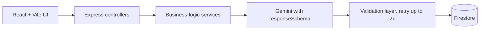
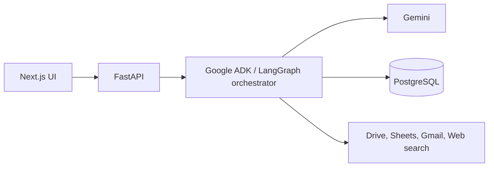

 

[About](#about) &nbsp;|&nbsp; [Tech Stack](#tech-stack) &nbsp;|&nbsp; [Projects](#featured-projects) &nbsp;|&nbsp; [Currently Building](#currently-building) &nbsp;|&nbsp; [Principles](#engineering-principles) &nbsp;|&nbsp; [Stats](#github-stats) &nbsp;|&nbsp; [Contact](#contact)

 

## About

I build complete web products end to end: responsive front ends, REST APIs, relational and document databases, payment flows, AI features and deployments.

My work sits between **solid backend engineering** (authentication, role-based access, validation, data integrity) and **premium UI/UX** (fast, accessible, carefully designed interfaces). Lately I've been focused on integrating LLMs into real products in a way that is structured, validated and auditable, rather than a thin wrapper around a prompt.

<table>
  <tr>
    <td width="150"><b>Role</b></td>
    <td>Full Stack Developer, open to SDE roles</td>
  </tr>
  <tr>
    <td><b>Education</b></td>
    <td>B.Tech CSE (Artificial Intelligence), IIMT College of Engineering, Greater Noida, Class of 2026</td>
  </tr>
  <tr>
    <td><b>Focus</b></td>
    <td>AI-integrated web apps, secure backends, polished UI</td>
  </tr>
  <tr>
    <td><b>Location</b></td>
    <td>Ghaziabad, Uttar Pradesh, India</td>
  </tr>
</table>

> [!TIP]
> **Open to Full Stack Developer and SDE roles.** The quickest way to reach me is by [email](mailto:rohitkumarrrx@gmail.com) or on [LinkedIn](https://linkedin.com/in/roul-max).

 

## Tech Stack

  <picture>
    <source media="(prefers-color-scheme: dark)" srcset="https://skillicons.dev/icons?i=react,nextjs,ts,js,nodejs,express,postgres,mongodb,supabase,firebase,tailwind,vite,java,docker,git,github,vercel&perline=9&theme=dark" />
    
  </picture>

<table>
  <tr>
    <td width="150"><b>Frontend</b></td>
    <td>React, Next.js (App Router), TypeScript, Tailwind CSS, Vite, Framer Motion, React Router</td>
  </tr>
  <tr>
    <td><b>Backend</b></td>
    <td>Node.js, Express.js, REST APIs, JWT authentication, role-based access control (RBAC), WebSockets</td>
  </tr>
  <tr>
    <td><b>Databases</b></td>
    <td>PostgreSQL, MongoDB, Supabase, Firebase Firestore</td>
  </tr>
  <tr>
    <td><b>AI / LLM</b></td>
    <td>Google Gemini (<code>@google/genai</code>), schema-constrained JSON outputs, text-to-speech and voice interfaces</td>
  </tr>
  <tr>
    <td><b>Payments</b></td>
    <td>Razorpay</td>
  </tr>
  <tr>
    <td><b>DevOps and Tooling</b></td>
    <td>Docker Compose, Vercel, Render, Git and GitHub</td>
  </tr>
  <tr>
    <td><b>Languages</b></td>
    <td>TypeScript, JavaScript, Java, SQL, HTML and CSS</td>
  </tr>
</table>

 

## Featured Projects

### Flagship: Rayeva-AI &nbsp;·&nbsp; Sustainable Commerce AI

Applied AI for eco-friendly e-commerce. The platform automates catalog intelligence and impact reporting while keeping **business logic deterministic and AI output structured, validated and logged**.

<table>
  <tr>
    <td width="50%" valign="top">

**AI Auto-Category and Tag Generator**

Turns a product name and description into a category, sub-category, SEO tags, sustainability filters and an eco score, returned as schema-constrained JSON.

</td>
    <td width="50%" valign="top">

**AI Impact Reporting Generator**

Plastic saved and carbon avoided are computed by backend rules. The AI only turns those numbers into a readable impact statement.

</td>
  </tr>
  <tr>
    <td colspan="2">

**Reliability layer:** every AI response is validated against allowed categories and score ranges before it is saved, retried up to twice if malformed, and logged (prompt, raw response, timestamp, status) for auditability.

</td>
  </tr>
</table>

[**Live demo**](https://rayeva-ai.vercel.app) &nbsp;·&nbsp; [**Source code**](https://github.com/Roul-max/Rayeva-AI)

 

### More Projects

<table>
  <tr>
    <td width="50%" valign="top">

#### ACE-ERP
Multi-module ERP platform with **JWT authentication and role-based access control**, split into separate frontend and backend services and containerised with Docker Compose.

[Source code](https://github.com/Roul-max/ACE-ERP)

</td>
    <td width="50%" valign="top">

#### Impulse
E-commerce storefront with a React, Vite and TypeScript front end, a dedicated backend, client-side routing, a Tailwind design system, **Razorpay payments** and Gemini integration.

[Live demo](https://impulse-wine-delta.vercel.app) &nbsp;·&nbsp; [Source code](https://github.com/Roul-max/Impulse)

</td>
  </tr>
  <tr>
    <td width="50%" valign="top">

#### GharPayy
Property rental CRM backed by **Supabase (PostgreSQL)**, with **Razorpay** handling payments.

<!-- Add your GharPayy links here, for example: [Live demo](...) · [Source code](...) -->

</td>
    <td width="50%" valign="top">

#### Catherine
Voice-first personal AI assistant built with Next.js and Gemini. Speech output uses **Gemini TTS with a Web Speech API fallback**, so it keeps working when the primary voice service is unavailable.

[Live demo](https://catherine-ai.vercel.app)

</td>
  </tr>
</table>

 

### In Production: Papriwala &nbsp;·&nbsp; POS and Digital Ordering

A production point-of-sale and online ordering platform for **Badrinarayan Papriwale**, a sweets shop.

- Live order flow with WebSocket updates, role-based staff access, and thermal printer and cash drawer integration through QZ Tray.
- Security-reviewed and hardened: server-validated order totals, atomic stock decrements through a Postgres RPC, and bcrypt-hashed credentials.
- Hosted on Vercel, Render and Supabase.

 

### Also on My GitHub

| Project | What it is | Stack |
|:--|:--|:--|
| [**Mine**](https://github.com/Roul-max/Mine) | My developer portfolio, with a dark minimal design system and smooth motion. [Live](https://roulportfolio.vercel.app) | React, TypeScript, Vite, Tailwind CSS, Framer Motion |
| [**Speech**](https://github.com/Roul-max/Speech) | Audio-oriented web app with waveform visualisation and ZIP export, backed by Supabase. [Live](https://speech-orcin-ten.vercel.app) | React, TypeScript, Vite, WaveSurfer.js, Supabase |
| [**Quiz-Website**](https://github.com/Roul-max/Quiz-Website) | Browser-based quiz app with a JavaScript question bank | HTML, CSS, JavaScript |

 

## Currently Building

### CloudOps AI Agent &nbsp;·&nbsp; Enterprise Multi-Agent Platform

An enterprise-style agent that understands a request and uses tools to act on it, for example finding a monthly sales report, summarising it, flagging unusual drops and creating a Google Sheet.

**Goals:** multi-agent design, tool calling, authentication, RBAC, audit logs, agent memory, human approval for sensitive actions, error handling, agent evaluation and Cloud Run deployment.

 

## Engineering Principles

<table>
  <tr>
    <td width="50%" valign="top">

**Validate on the server**

The client is never trusted for prices, totals or permissions.

</td>
    <td width="50%" valign="top">

**Keep business logic deterministic**

Use AI only where probabilistic reasoning adds value. Numbers, pricing and access rules stay in plain, testable code.

</td>
  </tr>
  <tr>
    <td valign="top">

**Constrain and verify AI output**

Structured schemas, validation before persisting, retries on failure, and a log of every interaction.

</td>
    <td valign="top">

**Design for roles from day one**

Authentication, authorisation and audit trails are part of the architecture, not a late add-on.

</td>
  </tr>
</table>

 

## GitHub Stats

  <picture>
    <source media="(prefers-color-scheme: dark)" srcset="https://github-readme-stats.vercel.app/api?username=Roul-max&show_icons=true&hide_border=true&count_private=true&bg_color=0D1117&title_color=8B5CF6&icon_color=8B5CF6&text_color=C9D1D9" />
    
  </picture>
  &nbsp;
  <picture>
    <source media="(prefers-color-scheme: dark)" srcset="https://github-readme-stats.vercel.app/api/top-langs/?username=Roul-max&layout=compact&hide_border=true&bg_color=0D1117&title_color=8B5CF6&text_color=C9D1D9" />
    
  </picture>

 

## Education and Certification

<table>
  <tr>
    <td width="50%" valign="top">

**B.Tech, Computer Science and Engineering (Artificial Intelligence)**

IIMT College of Engineering, Greater Noida
Class of 2026

</td>
    <td width="50%" valign="top">

**Java Full-Stack Developer Certification**

Croma Campus Pvt. Ltd.

</td>
  </tr>
</table>

 

## Contact

Based in Ghaziabad, Uttar Pradesh, India

