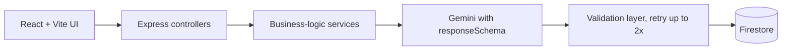

# Rohit Kumar

### Full Stack Developer · AI-Integrated Web Applications

Building production-minded web products with **React, Next.js, TypeScript and Node.js**, with a focus on clean architecture, secure backends and polished interfaces.

[About](#about) · [Tech Stack](#tech-stack) · [Featured Projects](#featured-projects) · [Currently Building](#currently-building) · [Engineering Principles](#engineering-principles) · [GitHub Stats](#github-stats) · [Education](#education--certification) · [Contact](#contact)

---

## About

I'm a **B.Tech Computer Science (Artificial Intelligence) graduate of 2026** from IIMT College of Engineering, Greater Noida, based in Ghaziabad, Uttar Pradesh. I build complete products end to end: responsive front ends, REST APIs, relational and document databases, payment flows, AI features and deployments.

My work sits at the intersection of two things I enjoy: **solid backend engineering** (authentication, role-based access, validation, data integrity) and **premium UI/UX** (fast, accessible, carefully designed interfaces). Lately I've been focused on integrating LLMs into real products in a way that is structured, validated and auditable rather than a thin wrapper around a prompt.

> [!TIP]
> **Open to Full Stack Developer and SDE roles.** If you're hiring or want to collaborate, the quickest way to reach me is by [email](mailto:rohitkumarrrx@gmail.com) or [LinkedIn](https://linkedin.com/in/roul-max).

---

## Tech Stack

<table>
  <tr>
    <td><b>Frontend</b></td>
    <td>React · Next.js (App Router) · TypeScript · Tailwind CSS · Vite · Framer Motion · React Router</td>
  </tr>
  <tr>
    <td><b>Backend</b></td>
    <td>Node.js · Express.js · REST APIs · JWT authentication · Role-based access control (RBAC) · WebSockets</td>
  </tr>
  <tr>
    <td><b>Databases</b></td>
    <td>PostgreSQL · MongoDB · Supabase · Firebase Firestore</td>
  </tr>
  <tr>
    <td><b>AI / LLM</b></td>
    <td>Google Gemini (<code>@google/genai</code>) · Schema-constrained JSON outputs · Text-to-speech and voice interfaces</td>
  </tr>
  <tr>
    <td><b>Payments</b></td>
    <td>Razorpay</td>
  </tr>
  <tr>
    <td><b>DevOps and Tooling</b></td>
    <td>Docker Compose · Vercel · Render · Git and GitHub</td>
  </tr>
  <tr>
    <td><b>Languages</b></td>
    <td>TypeScript · JavaScript · Java · SQL · HTML and CSS</td>
  </tr>
</table>

  

---

## Featured Projects

### ACE-ERP · Multi-module ERP platform
A full-stack enterprise resource planning system with **JWT authentication and role-based access control**, split into separate frontend and backend services and containerised with Docker Compose.

`TypeScript` `Docker Compose` `JWT` `RBAC`

[Source code](https://github.com/Roul-max/ACE-ERP)

---

### Impulse · E-commerce platform
A storefront built with a React + Vite + TypeScript front end and a dedicated backend service. It includes client-side routing, a Tailwind CSS design system, **Razorpay payment integration** and Google Gemini integration.

`React` `TypeScript` `Vite` `Tailwind CSS` `Razorpay` `Gemini` `Docker Compose`

[Live demo](https://impulse-wine-delta.vercel.app) · [Source code](https://github.com/Roul-max/Impulse)

---

### GharPayy · Property rental CRM
A CRM for property rentals backed by **Supabase (PostgreSQL)**, with **Razorpay** handling payments.

`Supabase` `PostgreSQL` `Razorpay`

<!-- Add your GharPayy repo and live links here, for example: [Live demo](...) · [Source code](...) -->

---

### Catherine · Personal AI voice assistant
A voice-first AI assistant built with Next.js and Gemini. Speech output runs through **Gemini TTS with a Web Speech API fallback**, so it keeps working when the primary voice service is unavailable.

`Next.js` `Gemini` `Text-to-Speech` `Web Speech API`

[Live demo](https://catherine-ai.vercel.app)

---

### Rayeva-AI · Sustainable Commerce AI
Applied AI for eco-friendly e-commerce. The platform automates catalog intelligence and impact reporting while keeping **business logic deterministic and AI output structured, validated and logged**.

- **AI Auto-Category and Tag Generator**: turns a product name and description into a category, sub-category, SEO tags, sustainability filters and an eco score, as schema-constrained JSON.
- **AI Impact Reporting Generator**: plastic saved and carbon avoided are computed by backend rules; the AI only turns those numbers into a readable impact statement.
- **Reliability layer**: every AI response is validated against allowed categories and score ranges before it is saved, retried up to twice if malformed, and logged (prompt, raw response, timestamp, status) for auditability.

`React` `Vite` `Tailwind CSS` `Node.js` `Express` `Google Gemini` `Firebase Firestore`

[Live demo](https://rayeva-ai.vercel.app) · [Source code](https://github.com/Roul-max/Rayeva-AI)

---

### Papriwala · POS and digital ordering platform *(production)*
A production point-of-sale and online ordering system for **Badrinarayan Papriwale**, a sweets shop.

- Live order flow with WebSocket updates, role-based staff access, and thermal printer and cash drawer integration through QZ Tray.
- Security-reviewed and hardened: server-validated order totals, atomic stock decrements through a Postgres RPC, and bcrypt-hashed credentials.
- Hosted on Vercel, Render and Supabase.

`Next.js` `TypeScript` `Supabase` `PostgreSQL` `WebSockets` `RBAC`

---

### More from my repositories

| Project | What it is | Stack | Links |
|---|---|---|---|
| **[Mine](https://github.com/Roul-max/Mine)** | My developer portfolio with a dark, minimal design system and smooth motion | React, TypeScript, Vite, Tailwind CSS, Framer Motion | [Live](https://roulportfolio.vercel.app) |
| **[Speech](https://github.com/Roul-max/Speech)** | Audio-oriented web app with waveform visualisation and ZIP export, backed by Supabase | React, TypeScript, Vite, WaveSurfer.js, Supabase, Tailwind CSS | [Live](https://speech-orcin-ten.vercel.app) |
| **[Quiz-Website](https://github.com/Roul-max/Quiz-Website)** | Browser-based quiz app with a JavaScript question bank | HTML, CSS, JavaScript | [Source](https://github.com/Roul-max/Quiz-Website) |

---

## Currently Building

### CloudOps AI Agent · Enterprise multi-agent platform *(in progress)*
An enterprise-style agent that understands a request and uses tools to act on it, for example finding a monthly sales report, summarising it, flagging unusual drops and creating a Google Sheet.

- **Architecture:** Next.js front end → FastAPI → Google ADK / LangGraph orchestrator → Gemini, PostgreSQL and Google Workspace tools (Drive, Sheets, Gmail) plus web search.
- **Goals:** multi-agent design, tool calling, authentication, RBAC, audit logs, agent memory, human approval for sensitive actions, error handling, agent evaluation and Cloud Run deployment.

`Next.js` `FastAPI` `Google ADK` `LangGraph` `Gemini` `PostgreSQL` `Cloud Run`

---

## Engineering Principles

- **Validate on the server.** The client is never trusted for prices, totals or permissions.
- **Keep business logic deterministic.** Use AI only where probabilistic reasoning adds value, and keep numbers, pricing and access rules in plain, testable code.
- **Constrain and verify AI output.** Use structured schemas, validate before persisting, retry on failure and log every interaction.
- **Design for roles from day one.** Authentication, authorisation and audit trails are part of the architecture, not a late add-on.
- **Ship it.** Every project above is deployed, because a running product teaches more than a local demo.

---

## GitHub Stats

  
  

---

## Education & Certification

| | |
|---|---|
| **B.Tech, Computer Science and Engineering (Artificial Intelligence)** | IIMT College of Engineering, Greater Noida · Class of 2026 |
| **Java Full-Stack Developer Certification** | Croma Campus Pvt. Ltd. |

---

## Contact

| | |
|---|---|
| **Email** | [rohitkumarrrx@gmail.com](mailto:rohitkumarrrx@gmail.com) |
| **Portfolio** | [roulportfolio.vercel.app](https://roulportfolio.vercel.app) |
| **LinkedIn** | [linkedin.com/in/roul-max](https://linkedin.com/in/roul-max) |
| **GitHub** | [github.com/Roul-max](https://github.com/Roul-max) |
| **Location** | Ghaziabad, Uttar Pradesh, India |

*Thanks for stopping by. If something here caught your eye, I'd love to hear from you.*

